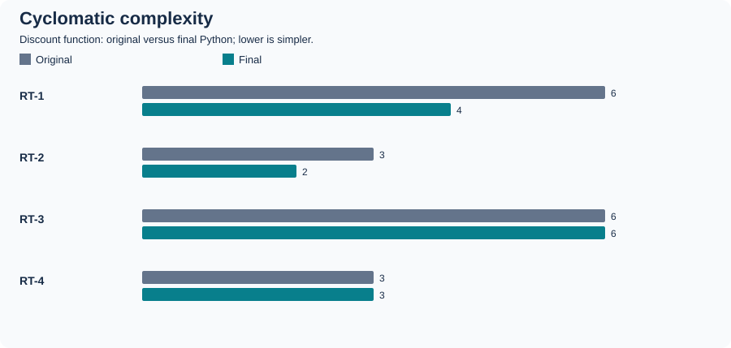
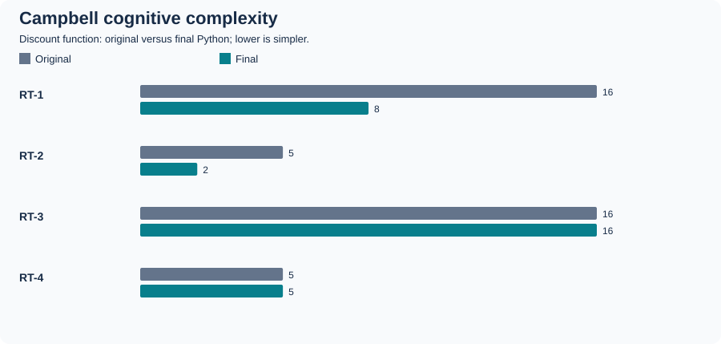
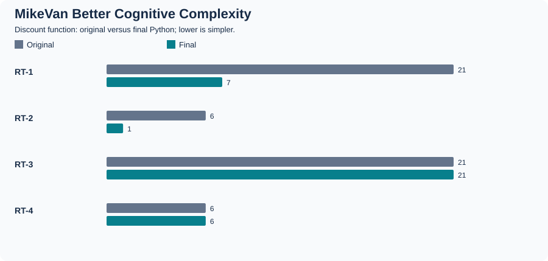
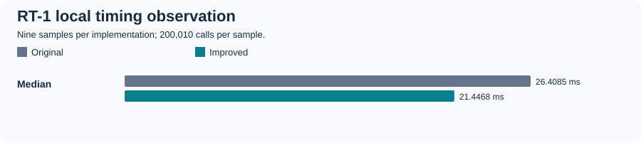
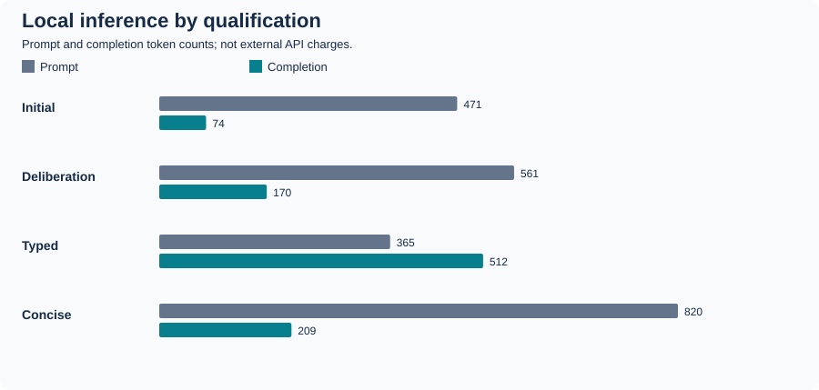
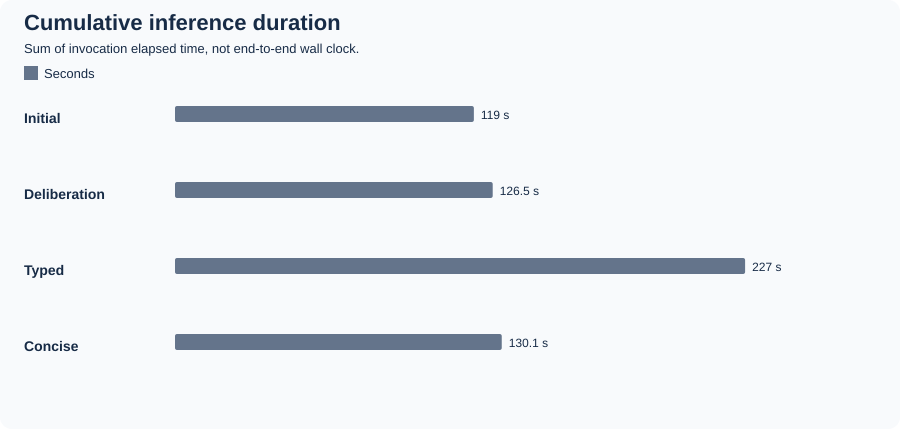

# Research analytics | Intellectus

Michael Van Geertruy — research originator. Derived analysis of preserved evidence, November 26, 2026.

## Round-trip experiments: behavior versus implementation

| Trial | Oracle cases / implementation | Optimization | Cyclomatic | Campbell | MBCC | Evidence |
| --- | --- | --- | --- | --- | --- | --- |
| RT-1 | 40,004 | Explicit | 6 → 4 | 16 → 8 | 21 → 7 | [raw](../experiments/RT-1/run-01/results.json) |
| RT-2 | 202 | Explicit | 3 → 2 | 5 → 2 | 6 → 1 | [raw](../experiments/RT-2/run-03/results.json) |
| RT-3 | 40,004 | Disabled | 6 → 6 | 16 → 16 | 21 → 21 | [raw](../experiments/RT-3/run-01/results.json) |
| RT-4 | 202 | Disabled | 3 → 3 | 5 → 5 | 6 → 6 | [raw](../experiments/RT-4/run-01/results.json) |

RT-1/RT-2 applied explicit equal-arm elimination. RT-3/RT-4 disabled it, preserving redundant structure. RT-1/RT-3 used representative samples of a large domain, not exhaustive enumeration; RT-2/RT-4 exhausted their 202 input pairs. Counts are per implementation, not unit-test counts. Complexity thresholds remain 15/12/15. These results refute the expectation that the existing representation implicitly optimizes these fixtures; they do not refute semantic abstraction as a research direction.

Median timing declined from 26.4085 ms to 21.4468 ms (18.8% lower). Small descriptive local sample; no generalized performance claim. [Raw samples](../experiments/RT-1/run-01/benchmark.json).

## Live committee qualification

| Trial | Operational gate | Typed AI | Calls | Prompt | Completion | Total tokens | Seconds | Evidence |
| --- | --- | --- | --- | --- | --- | --- | --- | --- |
| Initial | Pass | Not gated | 2 | 471 | 74 | 545 | 119.033 | [raw](../evidence/phase-I/live-committee-20261126-011149-7d31dc66.json) |
| Deliberation | Fail | False | 2 | 561 | 170 | 731 | 126.476 | [raw](../evidence/phase-I/live-deliberation-20261126-012738-70723710.json) |
| Typed | Fail | False | 2 | 365 | 512 | 877 | 226.955 | [raw](../evidence/phase-I/live-typed-deliberation-20261126-013954-3ed44904.json) |
| Concise | Pass | True | 4 | 820 | 209 | 1029 | 130.068 | [raw](../evidence/phase-I/live-concise-deliberation-20261126-015216-dc8477f1.json) |

The final concise trial: deterministic candidate verified over 25 input pairs in two languages; AI conceptual hypothesis contradicted, zero of two revision attempts corrected it; domain specialist abstained. No verified incremental conceptual or domain contribution. Operational pass is not semantic success. Initial and final passes use different gate definitions and are not directly comparable accuracy scores. Total tokens are local compute, not billed external API tokens. CPU/GPU and memory measurements were not retained in these records and are not estimated.

## P1/P2 deterministic pilot

| Subject | Behavioral class | Candidate outcome |
| --- | --- | --- |
| branch | A | verified-in-scope |
| iteration | A | verified-in-scope |
| direct | A | verified-in-scope |
| lookup | A | verified-in-scope |
| shift | B | verified-in-scope |
| late | C | contradicted |

Four equivalent subjects, two distinct controls, three canonical identities. 60 complete verification cases per run; 48 discovery observations per run; two byte-identical evidence records. The late control is distinguished only on held-out verification: (4,1) predicted 9, observed 10. No AI. This is an engineering pilot, not RT-5.

Evidence: [first run](../evidence/phase-I/pilot-56348eb740814dcfbd66090989adcf46.json) and [second run](../evidence/phase-I/pilot-5c4b6680b7c34b92b238aa926f2267e4.json).

## Measurement integrity

[Machine-readable derived metrics](metrics.json) | [Research curriculum](../research/Testing-Curriculum.md) | [Decision rationale](../research/Research-Decision-Register.md)

All chart values derive from preserved JSON; no synthetic results, success probabilities, or pooled case counts across unlike protocols. The benchmark and live trials are descriptive. Test-suite results are separate from research acceptance criteria.
