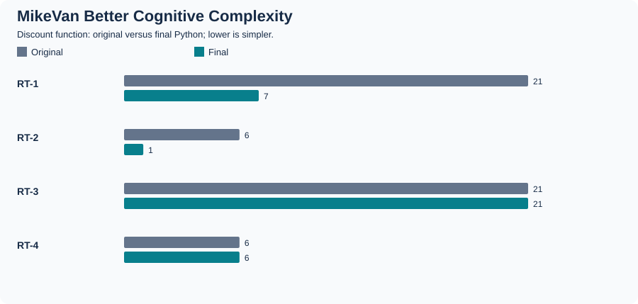
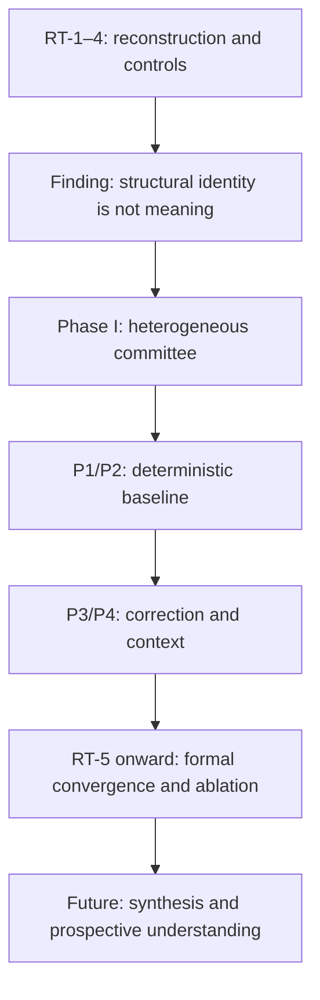

  
  <h1>Intellectus</h1>
  
<strong>Semantic Software Engineering Platform</strong>

  
Semantic understanding beyond implementation.

  
<a href="https://mikevan.github.io/Intellectus/"><strong>Visit the Intellectus website</strong></a>

## Our mission

The mission of Intellectus is to develop and maintain an open-source Semantic Software Engineering Platform that enables artificial intelligence systems to understand the purpose, behavior, and methods of software systems by applying a flow-based semantic model represented through a temporal ontology.
git -C 'C:\workspace-Intellectus' commit --only -m 'Link to source code from the Intellectus homepage' -- site/ArchitectureRepository/ProjectDocumentation/index.md
if ($LASTEXITCODE -eq 0) {
    git -C 'C:\workspace-Intellectus' push origin main
}
Through independently operating specialist models, deterministic analysis, LoRA training, and Colibri-based inference, Intellectus seeks to acquire, verify, preserve, and apply that understanding independently of the original implementation.

[Source code](https://github.com/mikevan/Intellectus/tree/main)

## Why Intellectus?

Software contains knowledge about how to accomplish tasks, but that knowledge is usually bound to source code, frameworks and runtime assumptions. Intellectus investigates whether an AI system can acquire the meaning of a software system, retain it independently, and use it to construct a new implementation. The goal is understanding, not translation.

## Explore the project

| Explore | What you’ll find |
| --- | --- |
| [Projects and modules](https://mikevan.github.io/Intellectus/projects.html) | the modular runtime and research components. |
| [Get started](https://mikevan.github.io/Intellectus/get-started.html) | begin with the research model and reproduction prerequisites. |
| [Documentation](https://mikevan.github.io/Intellectus/documentation.html) | user, developer and architecture guides. |
| [Research](https://mikevan.github.io/Intellectus/research.html) | questions, methods, results and future work. |
| [Architecture Repository](https://mikevan.github.io/Intellectus/archive.html) | original research records and source documents. |
| [Analytics](https://mikevan.github.io/Intellectus/analytics.html) | measured historical results and their interpretation. |
| [Downloads](https://mikevan.github.io/Intellectus/downloads.html) | releases, compatibility and verification. |
| [Community](https://mikevan.github.io/Intellectus/community.html) | contribute and participate. |

## Understanding through reconstruction

[The round-trip experiment](https://mikevan.github.io/Intellectus/round-trip.html) starts with Python, acquires a temporal ontology, generates TypeScript, then independently acquires a new ontology from TypeScript and reconstructs Python without the original source. Independent verification compares the two Python applications.

## Semantic-first development

[The semantic-first workflow](https://mikevan.github.io/Intellectus/semantic-first.html) starts with a developer-authored semantic model rather than existing source. The model expresses required behavior; languages become implementation choices.

[Charter](https://mikevan.github.io/Intellectus/charter.html) · [Standards](https://mikevan.github.io/Intellectus/standards.html) · [Validation](https://mikevan.github.io/Intellectus/testing.html) · [Glossary](https://mikevan.github.io/Intellectus/glossary.html) · [Semantic model](https://mikevan.github.io/Intellectus/semantic-model.html)

Research findings and evidence

## Research at a glance

| Finding | Evidence | Interpretation |
|---|---|---|
| Cross-language reconstruction | RT-1 through RT-4 | Demonstrated within declared obligations |
| Implicit optimization | Paired explicit/disabled optimization trials | Not demonstrated; motivated redesign |
| Heterogeneous committee | Four live qualifications | Operational feasibility, not successful AI understanding |
| Behavioral convergence | P1/P2; four equivalent implementations, two controls | Demonstrated on bounded arithmetic fixtures |
| Deliberative correction | [P3 runs](site/ArchitectureRepository/research/P3-P4-Research-Record.md#p3--deliberative-correction) | Two live runs missed qualification |
| Domain contribution | [P4 pilots](site/ArchitectureRepository/research/P3-P4-Research-Record.md#p4--contribution-of-domain-context) | Context improved explanations. Strict verified claims remained at 0/8. |

[Research analytics](site/ArchitectureRepository/analytics/README.md) · [Testing curriculum](site/ArchitectureRepository/research/Testing-Curriculum.md) · [Decision register](site/ArchitectureRepository/research/Research-Decision-Register.md) · [Architecture Repository](site/ArchitectureRepository/README.md)

The paired experiments showed that the existing representation preserves redundant structure unless explicitly transformed. This finding led to a redesign of the knowledge model, not a retrospective change to experimental criteria.

## Research program

Read the [continuity charter](site/ArchitectureRepository/Intellectus-Research-Continuity.md) for the intellectual vision, attribution, and instructions for future researchers. All historical reports, original evidence and source remain preserved. No claim of general semantic understanding or production readiness is made.

The monorepo retains constituent projects at its root; [snapshot provenance](snapshot-sources.json) records their origin. See the [architecture decision](site/ArchitectureRepository/architecture/ADR-001-Intellectus-Architecture.md) for the consolidation. Individual component licensing applies.

