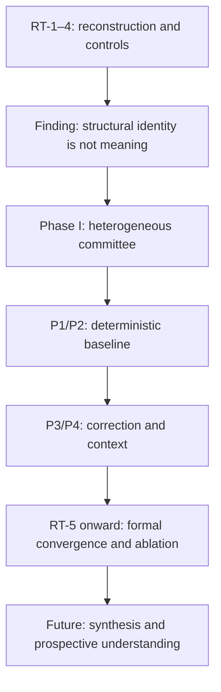

# Intellectus

**Research into implementation-independent computational understanding**

Michael Van Geertruy | Open research | Experimental software

Intellectus investigates whether a system can establish what software does without preserving incidental implementation choices. The research combines deterministic analysis, independent verification and specialized AI hypotheses in an evidence-grounded knowledge model.

## Research at a glance

| Finding | Evidence | Interpretation |
|---|---|---|
| Cross-language reconstruction | RT-1 through RT-4 | Demonstrated within declared obligations |
| Implicit optimization | Paired explicit/disabled optimization trials | Not demonstrated; motivated redesign |
| Heterogeneous committee | Four live qualifications | Operational feasibility, not successful AI understanding |
| Behavioral convergence | P1/P2; four equivalent implementations, two controls | Demonstrated on bounded arithmetic fixtures |
| AI self-correction and contextual value | P3/P4 | Outstanding hypotheses |

[Research analytics](ArchitectureRepository/analytics/README.md) · [Testing curriculum](ArchitectureRepository/research/Testing-Curriculum.md) · [Decision register](ArchitectureRepository/research/Research-Decision-Register.md) · [Architecture Repository](ArchitectureRepository/README.md)

The paired experiments showed that the existing representation preserves redundant structure unless explicitly transformed. This finding led to a redesign of the knowledge model, not a retrospective change to experimental criteria.

## Research program

Read the [continuity charter](ArchitectureRepository/Intellectus-Research-Continuity.md) for the intellectual vision, attribution, and instructions for future researchers. All historical reports, original evidence and source remain preserved. No claim of general semantic understanding or production readiness is made.

The monorepo retains constituent projects at its root; [snapshot provenance](snapshot-sources.json) records their origin. See the [architecture decision](ArchitectureRepository/architecture/ADR-001-Intellectus-Architecture.md) for the consolidation. Individual component licensing applies.
