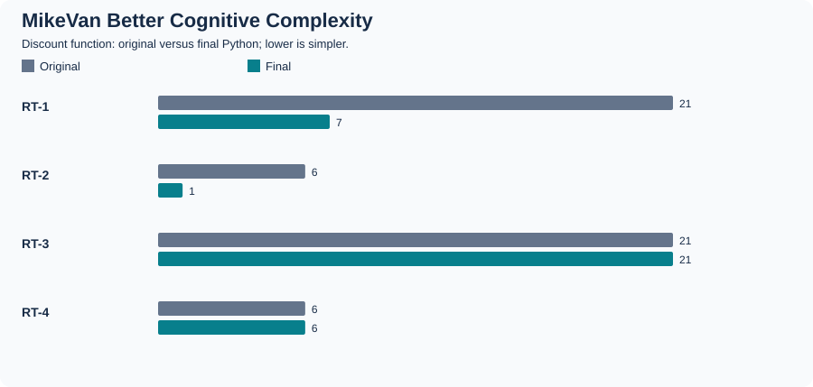

# Intellectus | Architecture Repository

**Research director: Michael Van Geertruy**

The research program seeks an evidence-grounded representation of computational meaning that is not dictated by programming language or implementation. Its findings are published openly, including unsuccessful hypotheses.

## Research portfolio

| Read | Purpose |
|---|---|
| [Analytics and charts](analytics/README.md) | Quantitative results, complexity, local inference overhead, verified behavior |
| [Testing curriculum](research/Testing-Curriculum.md) | Research questions, controls, gates, sequence and status |
| [Research decision register](research/Research-Decision-Register.md) | Evidence supporting each architectural direction |
| [Research continuity charter](Intellectus-Research-Continuity.md) | Intellectual vision, authorship, roadmap and reproduction |
| [Current scope](research/Current-Research-Scope.md) | Contemporary understanding first; future reasoning deferred |
| [Architecture and implementation plan](architecture/Intellectus-Architecture-and-Implementation-Plan.md) | Research backend and technical roadmap |
| [Semantic knowledge contract](architecture/Semantic-Knowledge-Contract.md) | Claim, evidence and specialist interfaces |
| [Style manual](standards/Intellectus-Style-Manual.md) | Documentation and engineering conventions |

Start with the [experiment environment setup](ProjectDocumentation/experiment-setup.md), then choose the [run instructions for the experiment](ProjectDocumentation/experiment-runs.md).

## Experimental record

| Stage | State | Reports |
|---|---|---|
| RT-1 | Complete | [Report](experiments/RT-1/RT-1-Experiment-Report.md) |
| RT-2 | Complete | [Protocol](experiments/RT-2/RT-2-Experiment-Protocol.md), [report](experiments/RT-2/RT-2-Experiment-Report.md) |
| RT-3 | Complete | [Report](experiments/RT-3/RT-3-Experiment-Report.md) |
| RT-4 | Complete | [Report](experiments/RT-4/RT-4-Experiment-Report.md) |
| RT-1–4 interpretation | Complete | [Research summary](research/Intellectus-RT-1-4-Research-Summary.md) |
| Phase I | Qualified operationally | [Foundation](research/Phase-I-Research-Foundation.md), [findings](research/Phase-I-Live-Deliberation-Findings.md) |
| P1/P2 | Engineering pilots passed | [Findings](research/P1-P2-Pilot-Findings.md) |
| P3/P4 | P3 did not qualify. P4 completed two exploratory pilots. | [Research record](research/P3-P4-Research-Record.md) |
| RT-5 | Draft; not executed | [Draft protocol](experiments/RT-5/RT-5-Draft-Protocol.md) |

## Design and evidence

- [Research direction and owner decisions](architecture/Research-Direction.md)
- [Architecture ADR](architecture/ADR-001-Intellectus-Architecture.md)
- [Future linguistic sharding spike](research/Intellectus-Linguistic-Sharding-Spike.md)
- [Raw qualification evidence](evidence/phase-I/)
- [Historical artifact manifest](evidence/historical-manifest.json)
- [Research implementation](../Understanding/research/knowledge/)

Historical documents retain their original wording, former internal classification and machine paths. The owner authorized open research publication. The supplied artifact directories are selected preserved evidence, not a complete standalone build environment. New analyses interpret, but do not modify, frozen experiment records.
